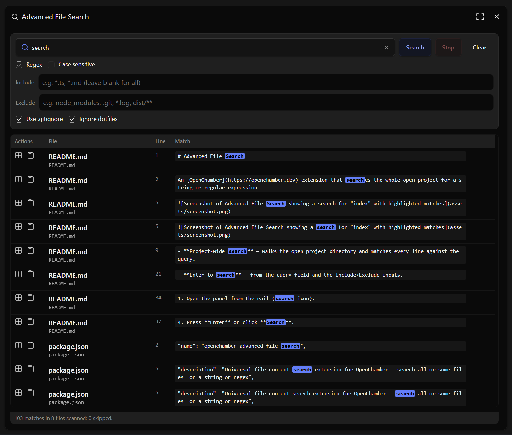

# Advanced File Search

An [OpenChamber](https://openchamber.dev) extension that searches the whole open project for a string or regular expression.



## Features

- **Project-wide search** - walks the open project directory and matches every line against the query.
- **String or regex** - plain text is escaped automatically; the Regex toggle passes the query through as a regular expression.
- **Case sensitive toggle**
- **Include / Exclude globs** - comma-separated patterns. `*` stays inside a path segment, `**` spans directories. Examples: `*.ts, *.md`, `node_modules, *.log, dist/**`.
- **Use .gitignore** - honors the project's `.gitignore` patterns. Requires the `.gitignore` to be at the project root.
- **Ignore dotfiles** - skips files and directories whose name starts with `.`.
- **Per-row actions**:
  - **Add to context** - appends `[query] found in path:line` to the chat composer, so the agent can open the file where the term appears.
  - **Copy path** - copies the file path to the clipboard via `host.writeClipboard()`.

## Install

Requires OpenChamber 1.24.0 or newer.

1. Open **Settings → Extensions** in OpenChamber.
2. Install the folder (or a zip / git URL of this repository).
3. Approve the `files` capability when prompted.

## Usage

1. Open the panel from the rail (search icon).
2. Type a query. Leave **Regex** off for literal text.
3. Optionally narrow the scan with **Include** / **Exclude** patterns, `.gitignore`, and dotfile options.
4. Press **Enter** or click **Search**.
5. Use the row icons to send a match to the composer or copy its path.

## Development

```bash
pnpm install
pnpm run build        # esbuild -> panel/main.js (IIFE, minified)
pnpm exec tsc --noEmit --target ES2020 --moduleResolution bundler --module ESNext --lib ES2020,DOM panel/main.ts
```

Layout:

```
panel/index.html   UI markup + styles (OpenChamber theme variables)
panel/main.ts      TypeScript source
panel/main.js      Bundled IIFE - what the host loads (commit after build)
assets/            Screenshot
```

The host does not compile TypeScript; `panel/main.js` must be rebuilt and committed after every source change.
